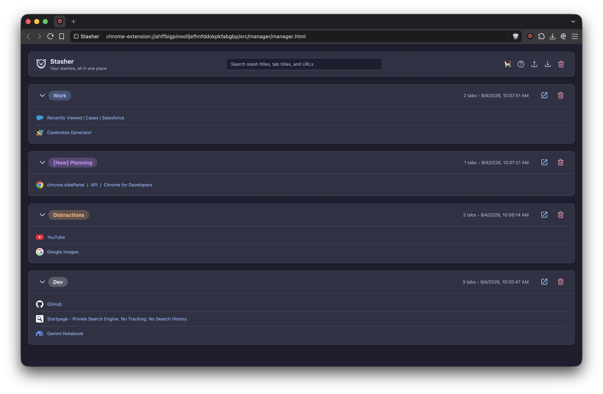
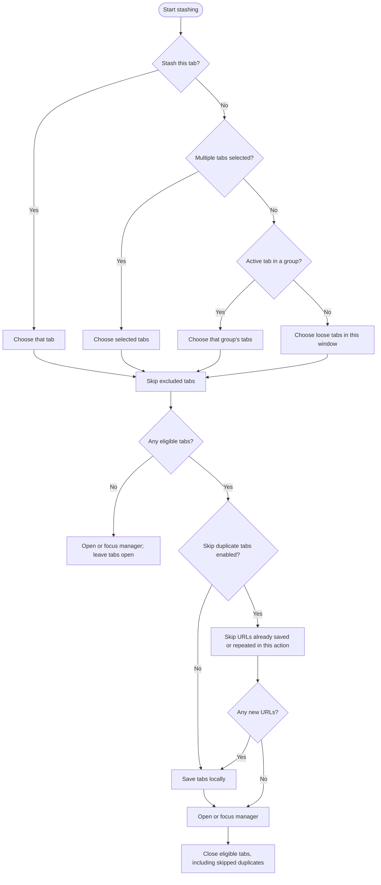
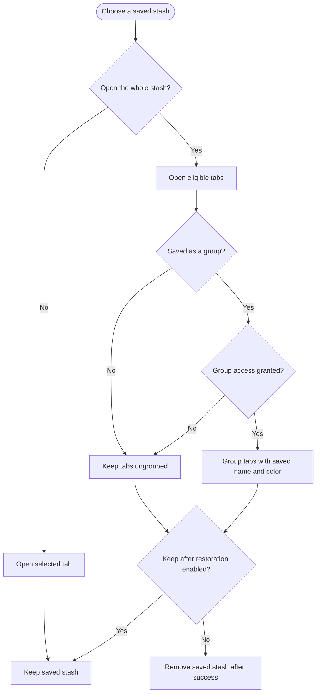

<p align="center">
  
</p>

<h1 align="center">Stasher</h1>

<p align="center">
  Your new favorite way of managing tabs! 🐈‍⬛
</p>

Stasher is a small, simple, and straightforward way to manage your tabs. Save tabs and tab groups to local Chrome storage so they stay safe even if your browser suddenly crashes or closes.

You can view, edit, search, restore, and clean up your saved tabs from Stasher's manager. It respects your space and time, and stays out of your way when you do not need it.

## Preview

<p align="center">
  
</p>

## How it works

Stasher's core workflow is simple: stash tabs, then unstash them when you need them.

### Save tabs

Right-click a tab and choose **Stash this tab**, or click the Stasher icon / press **Alt+S** to stash tabs from the current window.



Stasher accepts `http:`, `https:`, and `chrome-extension:` URLs. It skips its own manager, new-tab and blank pages, invalid URLs, and other URL schemes. Pinned tabs stay open unless you explicitly right-click one and choose **Stash this tab**. Tabs are saved before they are closed; if reading or saving fails, they stay open.

Enable **Skip duplicate tabs when stashing** to keep one saved copy of each exact URL across all stashes and within each new stashing action. The first occurrence is kept; different queries, fragments, protocols, or paths count as distinct URLs. Skipped browser tabs still close because their URLs are already saved. If every tab is duplicated, Stasher opens the manager without creating an empty stash or writing storage. Existing duplicates, imported backups, and saved titles are left intact. This works independently of **Keep tabs after restoration** and prevents retained tabs from being saved again after restoration.

Tab-group access is optional and is requested when you use the icon or shortcut. With access, Stasher saves the group name and color when the eligible tabs all belong to one group. A selection spanning groups or including loose tabs is saved as a loose stash. Right-clicking a single tab also saves it as a loose stash. If access is declined, tabs are still saved without group metadata; the next icon or shortcut use requests access again.

### Restore tabs

Click a saved tab's link to open it individually; the stash stays saved. To restore a whole stash, use its restore button or double-click its title. Settings can make a title double-click open the title/color editor instead.



Restoring uses existing group permission and never requests it. Renaming or recoloring a loose stash does not turn it into a group. If there are no eligible URLs, the stash stays saved. If restoration or stash removal fails, the stash is kept, though some tabs may already have opened. Restored tabs open unpinned and in the background and load normally; successful whole-stash restoration removes the stash without adding an Undo action unless **Keep tabs after restoration** is enabled.

In the manager, search stash names, tab titles, and URLs, rename stashes, change their colors, or remove saved tabs and stashes. The **More actions** (⋮) button opens Help, Export, Import, Settings, and Delete all stashes; click outside or press Escape to close it. Import and export JSON backups to move your stashes between devices. Saved titles and URLs stay in Chrome local storage on this device, with no account or cloud sync.

Enable **Restore stashes in a new window** in Settings to open all saved pages in one native window without a spare blank tab. The restore button and title double-click both follow this setting. Recreated browser groups stay in that window.

### Settings

Open **More actions → Settings**. Changes save automatically on this device and synchronize between open manager tabs. All five switches default off:

| Setting | Default behavior |
| --- | --- |
| Open Stasher on browser startup | Does not open automatically. |
| Keep tabs after restoration | Removes the saved stash after successful restoration. |
| Restore stashes in a new window | Restores into the current window. |
| Skip duplicate tabs when stashing | Duplicate tabs are allowed. |
| Double-click stash titles to edit | Double-click restores the stash. |

Startup opening reuses an existing manager or opens one pinned in the background in a normal window, preserving your selected tab. It does not stash tabs. Keeping tabs applies only to whole-stash restoration; individual saved links keep their usual behavior. Settings are not included in stash exports.

Stasher opens on demand by default, with search inside the manager and light/dark themes that follow your browser configuration. It is simple on purpose. It's your mess. You deal with it.

## Installation

Install Stasher from the [Chrome Web Store](https://chromewebstore.google.com/detail/stasher/feepkkcjmhhlmbghklpakdijphnlfjok).

## A small note about Firefox

Stasher has always been developed for Chromium-based browsers. Firefox is not officially supported.

It may still be possible to make Stasher compatible with Firefox, but doing so could require adjustments or a port. Contributions are welcome.

## Development

If you plan to fix bugs or develop new features, this is the place to start.

The project has no runtime dependencies. Run the test suite with Bun:

```bash
bun test
```

Before releasing, test the extension in Chrome and at least one other Chromium-based browser, such as Brave or Edge. The release workflow is documented in [GUIDE.md](.github/workflows/GUIDE.md).

## Contributing

Stasher was, and still is, mostly built for myself. That means there are things I intentionally avoided, whether by design or otherwise.

If you see something you would like to improve, be my guest. I would be happy to revise this together and build a community around it. The only thing I ask is that you respect the way I write code.

Thanks for taking the time to test Stasher and give it a try.

## Support

If you would like to support the project, you can [buy me a coffee via PayPal](https://paypal.me/ivanperezf).

## Icon palette

* Red: [#ef5b5b](https://www.color-hex.com/color/ef5b5b)
* Purple: [#855bef](https://www.color-hex.com/color/855bef)
* Yellow: [#efde5b](https://www.color-hex.com/color/efde5b)
* Pink: [#ffa8a8](https://www.color-hex.com/color/ffa8a8)

Found a bug or have an idea? Please report it with enough context to reproduce the problem.

Thanks for everything and for taking the time to test Stasher.

Much love~ ❤️🐱
