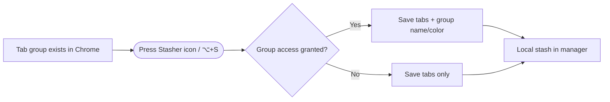
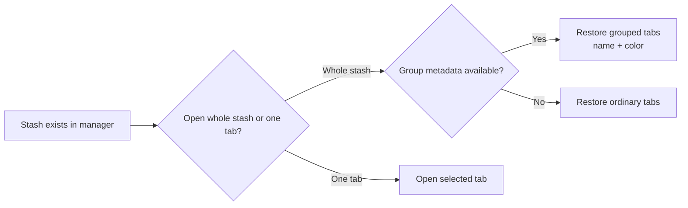

<p align="center">
  
</p>

<h1 align="center">Stasher</h1>

<p align="center">
  Your new favorite way of managing tabs! 🐈‍⬛
</p>

Stasher is a small, simple, and straightforward way to manage your tabs. Save tabs and tab groups to local Chrome storage so they stay safe even if your browser suddenly crashes or closes.

You can view, edit, search, restore, and clean up your saved tabs from Stasher's manager. It respects your space and time, and stays out of your way when you do not need it.

## Preview

<p align="center">
  
</p>

## How it works

Stasher's core workflow is simple: stash tabs, then unstash them when you need them.

### Save tabs



### Restore tabs



## Details

* Search stash names, tab titles, and URLs
* Rename stashes and change saved tab-group metadata, including the group color
* Import and export JSON backups
* Store saved tab titles and URLs in Chrome local storage on this device
* Use dark and light themes that follow your browser configuration
* Preserve pinned tabs when saving loose tabs so the tab strip keeps its usual shape

Tab-group access is optional. Clicking the Stasher icon requests access so group names and colors can be saved and restored. If access is declined, Stasher still saves the tabs but restores them as ordinary tabs. Clicking the icon again requests access until it is granted.

## Scope

* No sidebar or always-visible manager
* Search is limited to the Stasher manager
* No account or cloud sync
* No AI features or automatic modifications
* No attempt to offer every possible configuration

It is simple on purpose. It's your mess. You deal with it.

## Installation

Install Stasher from the [Chrome Web Store](https://chromewebstore.google.com/detail/stasher/feepkkcjmhhlmbghklpakdijphnlfjok).

## A small note about Firefox

Stasher has always been developed for Chromium-based browsers. Firefox is not officially supported.

It may still be possible to make Stasher compatible with Firefox, but doing so could require adjustments or a port. Contributions are welcome.

## Development

If you plan to fix bugs or develop new features, this is the place to start.

The project has no runtime dependencies. Run the test suite with Bun:

```bash
bun test
```

Before releasing, test the extension in Chrome and at least one other Chromium-based browser, such as Brave or Edge. The release workflow is documented in [GUIDE.md](.github/workflows/GUIDE.md).

## Contributing

Stasher was, and still is, mostly built for myself. That means there are things I intentionally avoided, whether by design or otherwise.

If you see something you would like to improve, be my guest. I would be happy to revise this together and build a community around it. The only thing I ask is that you respect the way I write code.

Thanks for taking the time to test Stasher and give it a try.

## Support

If you would like to support the project, you can [buy me a coffee via PayPal](https://paypal.me/ivanperezf).

## Icon palette

* Red: [#ef5b5b](https://www.color-hex.com/color/ef5b5b)
* Purple: [#855bef](https://www.color-hex.com/color/855bef)
* Yellow: [#efde5b](https://www.color-hex.com/color/efde5b)
* Pink: [#ffa8a8](https://www.color-hex.com/color/ffa8a8)

Found a bug or have an idea? Please report it with enough context to reproduce the problem.

Thanks for everything and for taking the time to test Stasher.

Much love~ ❤️🐱
